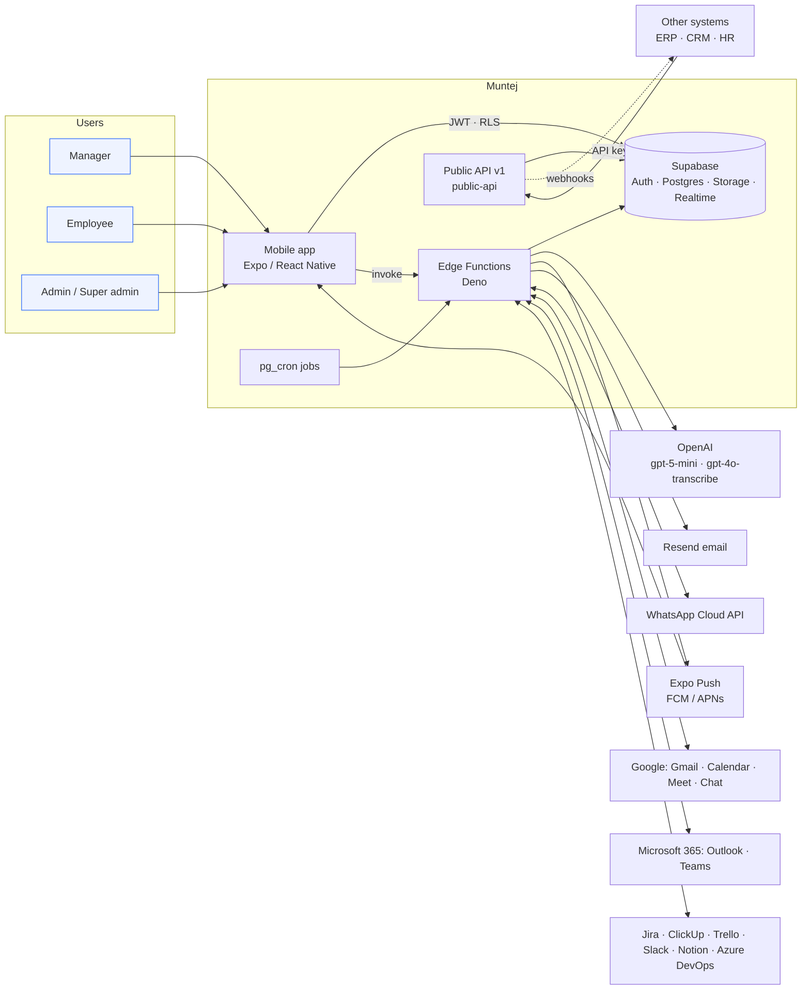
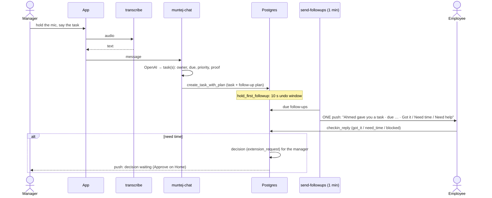
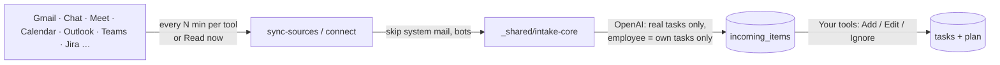

# Muntej: High-Level Design (HLD)

> Version 1.0 · 24 Oct 2026 · Source of truth: the code (`app/`, `src/`, `supabase/`). Details in [LLD.md](LLD.md);
> integration API in [../api/README.md](../api/README.md).

## 1. What the system does

Muntej is an AI task assistant for managers and employees in Saudi companies. Its promise is **"create it and forget it"**:
the manager gives a task once (voice or text), and **Saree3** (the assistant) assigns it, follows up, collects proof and
reports. The manager only sees **decisions and exceptions**. It is not a project-management tool: there are no boards
and no manual Gantt charts.

## 2. System context

## 3. Building blocks

| Layer | Technology | Responsibility |
|---|---|---|
| Mobile app | Expo SDK 57, React Native 0.86, Expo Router, TanStack Query, i18next (ar/en, RTL) | Screens, voice capture, Saree3 (assistant, walkthroughs, announcements), push handling, OTA updates (EAS Update, channel `preview`) |
| Identity | Supabase Auth: email OTP (+ optional TOTP 2FA) | One login, several **accounts** (tenants), one profile per account; `current_profile_id()` picks the active one |
| Data | Postgres + Row Level Security | Tenant wall (account), org tree (manager → reports), tasks, plans, alerts, decisions, tools |
| Files | Supabase Storage bucket `evidence` | Proof: photos, files |
| Logic | Postgres functions (RPC, triggers) + Deno Edge Functions | Sync rules near the data; AI, integrations and jobs in edge functions |
| AI | OpenAI, called **only** from edge functions (`OPENAI_API_KEY`) | Parsing tasks, reading tool messages, proof checks, step suggestions, speech to text |
| Jobs | `pg_cron` → `net.http_post` → edge function (with `x-cron-secret`) | Follow-ups, alerts, tool sync, summaries, autopilot, webhooks |
| Notifications | Expo Push, Resend, WhatsApp | One push per moment, Saree3's voice, budget of 3 everyday pushes per day |
| Integration | `public-api` (REST v1) + signed webhooks | Other systems create and read work and get events |

## 4. Edge functions (services)

| Function | Called by | Purpose |
|---|---|---|
| `muntej-chat` | app | Saree3's chat: create / change tasks, team questions, invites, objectives |
| `transcribe` | app | Voice → text (Saudi Arabic), with name hints from the person's accounts |
| `parse-task` | app | Text → structured task (legacy path) |
| `intake` | app | Pasted / shared messages → task suggestions |
| `sync-sources` | cron, every 10 min | Reads each connected tool **on its own schedule** → intake |
| `connect` | app | OAuth start / callback, token connect, settings, Read now, disconnect |
| `whatsapp` | Meta webhook | Voice notes and texts to Muntej's number → suggestions |
| `send-followups` | cron, every min | Sends due follow-ups (plans), receipt chases, then delivers alerts |
| `team-alerts` | cron, every 15 min | Late, at-risk, no-reply, overload, objective alerts |
| `autopilot` | cron, every 10 min | Chases late work, helps blocked work, rebalances, finds owners, auto-approves |
| `daily-summary` | cron, every 15 min | Morning brief per person (push / email / WhatsApp); Thursday → weekly receipt |
| `verify-proof` | trigger on review | AI check of the proof against "done"; tells the owner what's missing |
| `suggest-steps`, `suggest-skills` | app | AI steps for a task; skills for a person |
| `speak` | app | Text to speech for Saree3 |
| `invite`, `quick-login`, `delete-account`, `brand` | app | Invitation email, dev sign-in, self-delete, brand assets |
| `public-api` | external systems | REST v1 for integrations (API keys) |
| `webhook-dispatch` | cron, every min (when due) | Sends signed webhook deliveries with retries |

## 5. Main flows

### 5.1 Create it and forget it

### 5.2 Saree3 runs the task (follow-up plan)

- **Built in code** (`_shared/followup-plan.ts`) when the task is created: hand-off, receipt check, check-ins, risk
  check, due-time nudge. For work due **within a day** it adds a half-way check and "one hour left".
- **Sending** (`send-followups`) respects quiet hours, push on/off and daily limits. For same-day work, a reply only
  quiets the next 2 hours.
- **No confirmation** after the receipt check: Saree3 chases. After two silent chases, the manager gets one escalation.
- **Late work** (`autopilot`): kind reminders, then a decision for the manager (more time or move it) if nobody answers.
- **Blocked or need help** reaches the manager as an exception, together with what Saree3 already did.

### 5.3 Exceptions only: alerts and the budget

Alerts are rows in `alerts`, created by triggers and jobs and delivered by `deliverPending`. Exceptions (an assignment,
a decision, an escalation, a request answered) always push. Everyday updates push only up to 3 a day; the rest wait for
the morning brief. Three or more alerts at once are grouped into one push. Arabic notifications are forced RTL.

### 5.4 Tools → tasks (Your tools)

### 5.5 Proof and review

The owner submits work and the review is created. `verify-proof` checks the proof against "done". If something is
missing, the owner gets a push and both Home screens show "Missing: …". The reviewer approves, or the work is
auto-approved after N working days.

### 5.6 Integration (public API)

External systems use an account API key to create, read and update tasks, read people and decisions, and send messages
in. Webhooks push `task.*` and `decision.*` events, signed with HMAC-SHA256 and retried with backoff.

## 6. Multi-tenancy and security

- **Tenant wall:** every profile belongs to one account. RLS lets a person read only rows from their active account, and
  only the parts of the org tree they are allowed to see (`can_see_task`, `can_see_profile`, `is_manager_of`). The super
  admin can enter any account through a hidden seat profile.
- **Secrets:** the OpenAI, Google, Microsoft, Resend, WhatsApp and Expo secrets live only in edge-function environment
  variables, never in the app. OAuth tokens are encrypted (`seal`) in `connection_secrets`, which only the server reads.
- **Server-only paths:** `create_task_as` and `upsert_person_as` act as a given profile and are granted to
  `service_role` only.
- **API keys:** the API stores only the SHA-256 hash of each key. Keys have scopes and a per-minute rate limit, and every
  write is audited in `activity_log` with `actor_type` `agent`.
- **Cron jobs:** they call functions with `x-cron-secret`, which is kept in Vault.
- **Audit:** every AI or Saree3 action goes to `activity_log` (who, what, why, undoable).

## 7. Deployment and environments

| Part | How |
|---|---|
| Database | Migrations in `supabase/migrations`, applied with `scripts/db-apply.ps1` (Management API) |
| Edge functions | `npx supabase functions deploy <fn> --project-ref katwiedukkvssuxbjbqf --use-api` (config in `supabase/config.toml`); type-check first with `npx deno check` |
| App JS | EAS Update (OTA), `scripts/publish-update.ps1` → channel `preview`, runtime 1.1.0; the app checks on open and on return |
| App binary | EAS Build (Android APK `preview` profile), when native modules or icons change |
| Environments | One cloud project today (`katwiedukkvssuxbjbqf`); next: staging plus production projects with the same migrations |

## 8. Scaling notes

- **Jobs** process in bounded batches (followups 200 per run, alerts 300, connections 200, webhooks 100) and are
  idempotent: a row is marked sent or held, and the same message is never read twice (external id per tool).
- **Tool reading** is spread by each tool's own schedule. If the number of connections grows, split `sync-sources` into
  shards (hash of the connection id) and run them in parallel.
- **AI calls** are one call per message or task and bounded by input caps. A cheaper model is used where possible
  (`PARSE_MODEL`, `PROOF_MODEL`).
- **Hot paths** are indexed: tasks (owner, status/due), followups (status/scheduled), alerts (pending), deliveries (due).
- **Next steps:** read replicas for reports, a queue (pgmq) for intake bursts, per-tenant rate limits in the public API.
