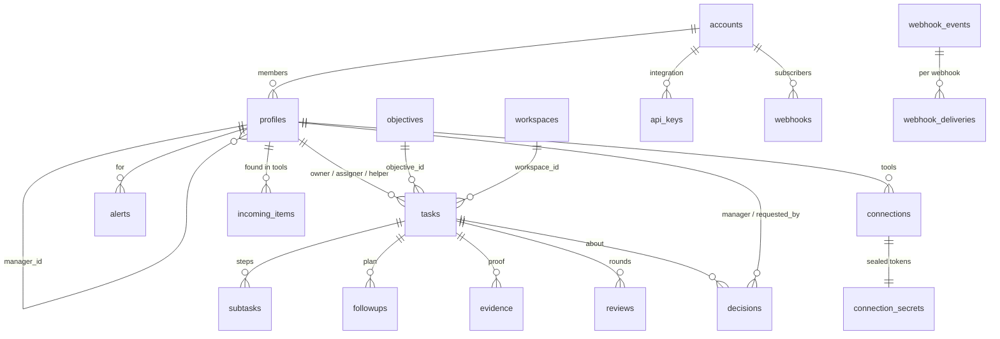
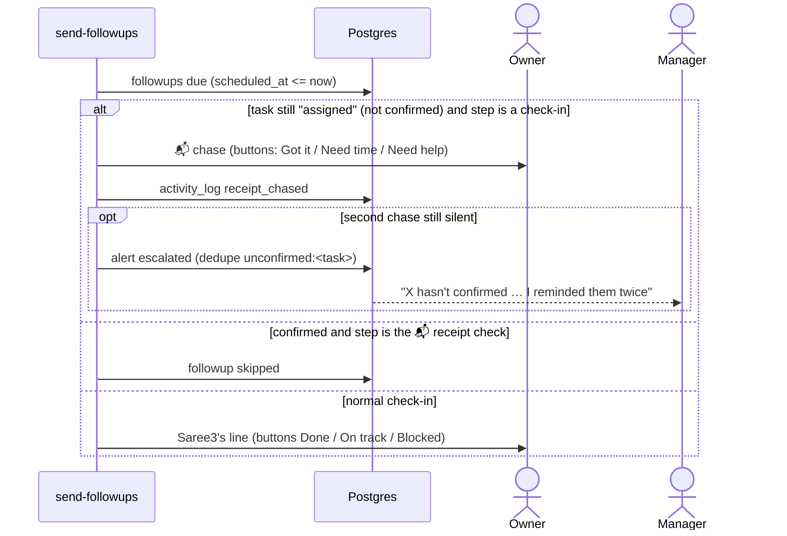
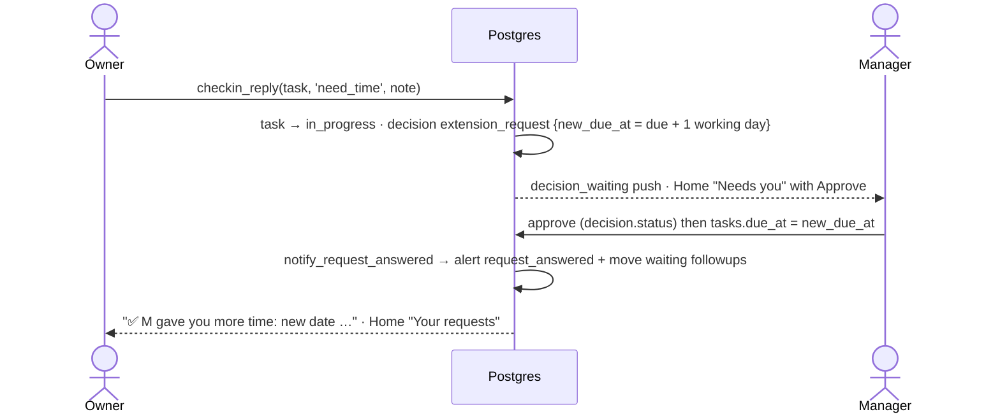
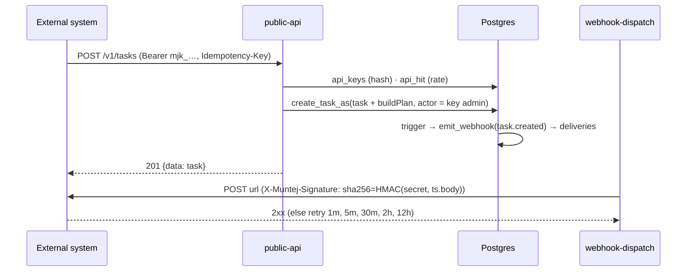

# Muntej: Low-Level Design (LLD)

> Version 1.0 · 24 Oct 2026 · Read with [HLD.md](HLD.md). Tables come from the live schema; the migrations in
> `supabase/migrations/` are the source of truth.

## 1. Data model

### 1.1 Entity relationships (core)



### 1.2 Tables

| Group | Table | Key columns | Notes |
|---|---|---|---|
| Tenancy | `accounts` | id, name, name_ar, status | One company (tenant) |
| | `account_sessions` | user_id, account_id | Which account a login is working in |
| | `profiles` | id, user_id, account_id, role (employee/manager/admin/super_admin), manager_id, full_name(_ar), email, title, skills, locale, weekly_capacity_hours, status, hidden, sector, phone, whatsapp_connected | One per account membership; `hidden` = super-admin seat |
| Work | `tasks` | id, title, description, owner_id, assigner_id, helper_id, status, priority, due_at, expected_close_at, progress, clarity_score, definition_of_done, proof_required, budget, estimate_hours, source, source_ref, objective_id, workspace_id, manager_touches | status: draft · assigned · in_progress · blocked · submitted · returned · done · cancelled |
| | `subtasks` | task_id, title, owner_id, done, position, due_at | Steps |
| | `evidence` | task_id, type, storage_path / url, uploaded_by | Proof files (bucket `evidence`) |
| | `reviews` | task_id, round, submitted_by, reviewer_id, decision, rating, auto_approve_at, ai_check | `ai_check` = {verdict, passed[], missing[], summary} |
| | `recurring_tasks` | freq, every, weekdays, time_of_day, rotation, next_due_at | `spawn_recurring_tasks` every 30 min |
| | `objectives`, `workspaces`, `workspace_members`, `achievements`, `task_links` | | Goals, projects, wins, links to tasks in other tools |
| Follow-up | `followups` | task_id, recipient_id, scheduled_at, channel, message, message_ar, status (scheduled/sent/skipped/cancelled), sent_at | The plan, one row per message |
| | `decisions` | task_id, manager_id, requested_by, type (extension_request · delay_risk · ambiguous_reply · reassignment · priority_question), status (pending/approved/declined/expired), details, recommendation(_ar) | Exceptions that need a person |
| | `alerts` | profile_id, kind, task_id, title(_ar), body(_ar), dedupe_key, delivered_at, deliver_after, sent_push, read_at | Inbox + push queue |
| | `notification_prefs` | channels, rules, quiet_hours, escalation | Per person |
| | `autopilot_prefs`, `autopilot_marks` | rules, chase_reminders, auto_approve_days | Saree3's autonomy per manager |
| | `daily_summaries` | profile_id, day, kind, channels | One brief a day |
| Tools | `connections` | profile_id, provider, account_label, status, last_sync_at, cursor, features, import_on, export_on, export_target, **read_every_min** | One per tool account; schedule 0 = manual |
| | `connection_secrets` | connection_id, data (sealed) | Server only |
| | `oauth_states` | state, provider, verifier | Cleaned hourly |
| | `incoming_items` | owner_id, source, external_id, sender, subject, body, summary, status (new/done/ignored/nothing), suggestions (jsonb) | Unique (owner, source, external_id) |
| Assistant | `chat_messages` | profile_id, role, content, task_id, action, payload | Saree3 chat history |
| | `features`, `feature_events` | key, audience, title(_ar), benefit(_ar) · state (seen/tried/adopted/later/not_interested) | Announcements ("New in Muntej") |
| | `coach_moments`, `onboarding`, `feedback`, `step_suggestions` | | Guidance and learning |
| Audit | `activity_log` | actor_type (muntej/user/agent), actor_id, subject_id, task_id, action, summary(_ar), reason, undoable, undo_payload | Every action, who / what / why |
| Agents | `agents`, `agent_runs` | recipe, schedule, autonomy | Custom automations |
| Devices | `push_tokens` | profile_id, token, platform | Expo push |
| Invites | `invite_codes`, `invite_joins`, `invite_attempts` | | Legacy codes (email invites now) |
| API | `api_keys` | account_id, name, prefix, key_hash, scopes[], actor_id, rate_per_min, revoked_at | Hash only |
| | `api_idempotency`, `api_rate` | (key_id, idem_key) · (key_id, minute) | 24 h / 1 day retention |
| | `webhooks`, `webhook_events`, `webhook_deliveries` | url, secret, events[] · event, payload · status, attempts, next_attempt_at | Outbound events |

### 1.3 Row Level Security (summary)

- `current_profile_id()` / `current_account_id()`: the profile of the account the caller is working in.
- `profiles`: visible only inside the same account (`same_account`). Employees see their branch; admins see the
  whole account.
- `tasks`: `can_see_task(id)` covers the owner, assigner, helper and anyone above them in the tree. Writes go through
  RPCs (`create_task_with_plan`, `set_task_status`, `update_task_from_chat`, …).
- `decisions`: the manager (to decide) and the requester (to see the answer). The app lists only `manager_id = me`.
- Server-only tables (`connection_secrets`, `api_*`, `webhook_*`) have RLS enabled and no policies.

## 2. Key database functions

| Function | Kind | What it does |
|---|---|---|
| `create_task_with_plan(p jsonb)` | RPC (invoker) | Inserts the task (draft when there's no owner) and its follow-up plan; computes clarity |
| `create_task_as(p, actor)` / `upsert_person_as(p, actor)` | service_role | Same rules, acting as a given profile (jobs, WhatsApp, API) |
| `checkin_reply(task, reply, note)` | RPC | done · on_track · blocked · **got_it** · **need_time** (→ `extension_request` decision with a suggested new date) |
| `set_task_status`, `require_proof` | RPC / trigger | Status changes; the owner can't submit without the required proof |
| `undo_chat_task` | RPC | 10-second undo: cancels the task and drops unsent notices |
| `hold_new_task_alert`, `hold_first_followup` | triggers | Hold the first messages until the undo window closes |
| `notify_subject_of_change` | trigger on activity_log | "X assigned you" / "X changed …" alerts (skips decision answers) |
| `notify_decision_waiting`, `notify_new_submission` | triggers | Manager alerts |
| `notify_request_answered` | trigger on decisions | One "answered" alert to the requester; an approved extension moves the waiting reminders |
| `nudge_waiting` | RPC | "Remind them for me" on Waiting on others |
| `set_my_sector`, `set_my_locale`, `set_my_phone` | RPC | Profile settings |
| `create_api_key`, `revoke_api_key` | RPC (admins) | Integration keys (the key is shown once) |
| `emit_webhook` + `webhook_task_events` / `webhook_decision_events` | triggers | Queue webhook deliveries |
| `spawn_recurring_tasks` | cron (30 min) | Creates the next instance of recurring tasks |

## 3. Edge functions (contracts)

All functions live in `supabase/functions/<name>/index.ts` and use `_shared/*`. **App** functions take the user's JWT
(`getCaller` → RLS client + profile id). **Cron** functions take the `x-cron-secret` header.

| Function | Auth | Input → output | Shared modules |
|---|---|---|---|
| `muntej-chat` | JWT | {message, history, focus?} → {reply, actions, tasks} | followup-plan, intake-core |
| `transcribe` | JWT | audio (base64 / multipart) → {text} | |
| `intake` | JWT | {action: ingest / add / ignore / edit / sync, …} → item | intake-core, connections |
| `connect` | JWT (callback: state) | start / callback / token / settings {features, read_every_min, …} / sync {provider, id?} / disconnect / targets / whatsapp | providers/*, connections |
| `sync-sources` | cron | {} → {connections, results}; reads only due connections | connections, notify |
| `whatsapp` | Meta signature | webhook → suggestions + reply | intake-core |
| `send-followups` | cron · JWT {test} | due followups → push; receipt chase; escalate; then `deliverPending` | push, notify |
| `team-alerts` | cron | → alerts (late, at risk, no reply, overload, objectives) | notify |
| `autopilot` | cron | → chases, help, rebalance, owners, auto-approve (+ decisions) | notify |
| `daily-summary` | cron · JWT {test} | → push / email / WhatsApp brief | push |
| `verify-proof` | cron secret (trigger) | {review_id} → reviews.ai_check + owner push | push |
| `public-api` | API key | REST v1 (see ../api/openapi.yaml) | followup-plan, intake-core |
| `webhook-dispatch` | cron | due deliveries → signed POSTs | |

### 3.1 `_shared/followup-plan.ts`: `buildPlan(opts) → PlanStep[]`

Inputs: title, dueAt, owner first name and language, self, helper, assigner, now. Steps
(`brief | check | risk | collect`):

| Case | Steps |
|---|---|
| No due date | brief → receipt check (+2 working h, others only) → check (+2 days) |
| Due within 24 h | brief → receipt (~1 h, a third of the time left) → half-way check (if ≥ 3 h) → "one hour left" → due now |
| Longer | brief → receipt → check (35 %) → risk (65 %) → collect (on the due date) |

Reminder times are moved into working hours (Sun–Thu, 09:00–17:00 Riyadh) when that still lands before the deadline.
Otherwise the real time is used, but never at night. Duplicate check times are merged. Messages are Saree3's lines,
picked at random per moment, and **never repeat the task title**, because the title is the push title. The receipt
check starts with 📬.

### 3.2 `_shared/notify.ts`: `deliverPending(admin)`

Rules for each pending alert (created in the last 24 h, not held), in order:
1. **Merged:** a `task_assigned` alert with a hand-off follow-up for the same person is marked "merged" and gets no push.
2. **Switched off:** the person turned this rule off.
3. **Quiet hours:** held (`deliver_after`).
4. **Budget:** exceptions always push (assigned, submission, decision, escalated, no reply, objective missed, request
   answered, and high-priority late / at-risk). Brief-only kinds wait for the morning. Others push up to 3 a day.
5. **Grouping:** 3+ alerts for one person become one push ("N updates") with one line each.

Pushes go through `sendPush`, which reaches all of the person's devices across their accounts. Arabic lines start with
an RLM mark so they read right to left.

### 3.3 Connectors: `_shared/providers/*` and `_shared/connections.ts`

```ts
interface Provider {
  oauth?: { authorizeUrl(state, redirect, verifier): string; exchange(code, verifier): Tokens };
  personalToken?: { fields: string[] };
  refresh(t: Tokens): Promise<Tokens>;
  account(t: Tokens): Promise<{ label: string; cursor?: object }>;
  fetchNew(t: Tokens, cursor: object, features?: Record<string, boolean>): Promise<{ items: Fetched[]; cursor: object }>;
  // two-way tools: listTargets / pushTask / closeTask
}
type Fetched = { externalId; source; text; sender; subject; receivedAt; structured? };
```

The Google connector has four switches per account:
- **Gmail:** inbox minus promotions, social, updates and forums. Automated senders are skipped by their headers and
  sender name.
- **Calendar:** meetings that ended and have notes.
- **Meet:** transcripts.
- **Chat:** human messages per space, bots skipped (Workspace accounts only).

`syncConnection(admin, conn)` refreshes the token, calls `fetchNew`, sends each item to `ingestMessage`, and updates
`last_sync_at`, `found_today`, `cursor` and `last_error`.

### 3.4 `_shared/intake-core.ts`: `ingestMessage(admin, input)`

1. **Dedupe:** skip if (owner, source, external_id) was already read.
2. **Extract:** OpenAI with a strict JSON schema. Tasks only come from a human sender in scope (never system mail).
   Each task gets owner (by name, role or To/Cc), due time, priority, description, done-definition, proof and budget.
3. **Filter:** email suggestions under 0.5 confidence are dropped. **An employee keeps only their own tasks.**
4. **Save:** the result goes to `incoming_items.suggestions`. Sure tasks are added automatically unless `confirmFirst`
   (email, chat, WhatsApp and the API always wait for an OK).

## 4. Sequences

### 4.1 Receipt chase (send-followups)



### 4.2 Extension request



### 4.3 Tool sync

```mermaid
sequenceDiagram
  participant C as pg_cron (10 min)
  participant SS as sync-sources
  participant P as Provider
  participant IC as intake-core
  participant DB as Postgres
  C->>SS: x-cron-secret
  SS->>DB: connections (due by read_every_min; 0 = manual)
  loop each due connection
    SS->>P: refresh token · fetchNew(cursor, features)
    P-->>SS: items (system mail / bots skipped)
    SS->>IC: ingestMessage(confirmFirst)
    IC->>DB: incoming_items (+ tasks when allowed)
    SS->>DB: last_sync_at, found_today, cursor
  end
```

### 4.4 Public API: create a task, then a webhook



## 5. App structure

- `app/`: routes (Expo Router). `(tabs)` = Home (01 manager / 25 employee), Tasks (38), Decisions (04), Summary (05).
  Stacks: 14 task detail, 42 Your tools, 12 Connect tools, 50 New in Muntej, settings, …
- `src/features/<feature>`: screens' logic, strings (`registerStrings(ns, {en, ar})`) and components.
- `src/lib/api`: Supabase client, TanStack Query hooks and keys. `src/theme/tokens.ts`: colours, sizes, fonts.
- Cross-cutting UI: Saree3 (`features/munti`), walkthrough (`features/walkthrough`: TourTarget + overlay),
  announcements (`features/launch`), notifications (`features/notifications/push.ts`: categories `checkin` and
  `handoff`), live OTA updates (`lib/useLiveUpdates`).
- RTL: `AppText` prefixes Arabic with RLM (Android ignores `writingDirection`). Layout follows `I18nManager`.
